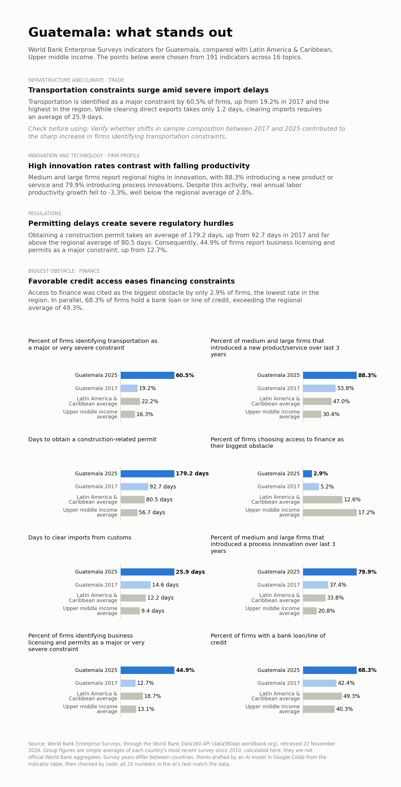
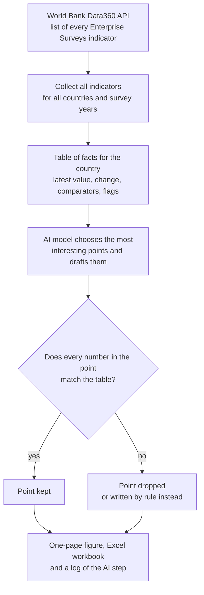

# Enterprise Surveys country briefs

Give this project a country code and it produces a one-page brief on what stands out in that country's business environment, with the data behind it in Excel.

It collects every national indicator of the [World Bank Enterprise Surveys](https://www.enterprisesurveys.org) from the World Bank's public APIs (about 200 indicators across 16 topics), compares the country with the countries and groups you choose, and asks an AI model to pick and draft the most interesting points. Code then checks every number the model wrote against the data, and drops any point that fails.



## How it works



The AI model never sees raw data and never does arithmetic.

| Step | Done by |
|---|---|
| Find every indicator in the API and collect it for all countries | Code |
| Calculate values, changes, group averages, ranks and flags | Code |
| Choose the most interesting points and draft them | AI model |
| Check every number in the draft against the table | Code |
| Drop any point with a number that is not in the table | Code |

Each run saves `ai_log_<code>.json` with the settings, the prompt, the model's full answer and the result of every check, so the AI's part can be audited. If no model is available, the points are written by rule from the table and the page says so.

## Run it

**In Google Colab (no installation, no API key)**

1. Download [`notebooks/03_ai_country_brief.ipynb`](notebooks/03_ai_country_brief.ipynb).
2. In [Colab](https://colab.research.google.com), choose File > Upload notebook and pick the file.
3. Set the country in the first code cell, then choose Runtime > Run all.

A run takes a minute or two. The AI model is the one built into Colab (`google.colab.ai`).

**On your own computer**

```
pip install -r requirements.txt
jupyter notebook
```

Outside Colab there is no built-in AI model, so the points are written by rule.

## Your choices

All choices are in the first code cell.

| Setting | What it does | Example |
|---|---|---|
| `COUNTRY` | The country the brief is about (three-letter ISO code) | `"GTM"` |
| `TOPICS` | Leave empty to search every indicator. List topics to get one point for each | `["Gender", "Finance"]` |
| `INDICATORS` | Indicators to include and chart, by code or by words from the name | `["GEND4", "sales growth"]` |
| `COMPARE_COUNTRIES` | Other countries to compare with | `["HND", "SLV"]` |
| `COMPARE_GROUPS` | Groups of countries to compare with | `["own region", "High income", "all countries"]` |
| `GROUP_STATISTIC` | How a group is summarised: the simple average of its countries, or the median | `"average"` |
| `USE_AI` | Set to `False` to write the points by rule, without an AI model | `True` |

Topic names follow the Enterprise Surveys website: Regulations, Taxes, Finance, Infrastructure and Climate, Gender, Trade, Competition and Public Procurement, Corruption, Informality, Dispute Resolution, Jobs, Workforce, Management Practices, Innovation and Technology, Firm Profile, and Biggest Obstacle.

A mistyped topic, group or indicator stops the run with a message that lists the valid names.

## What you get

| File | Contents |
|---|---|
| `brief_<code>.png` and `.pdf` | The one-page brief: the points, then one panel per indicator showing the country's latest and previous survey and every comparator |
| `brief_<code>.xlsx` | The workbook described below |
| `ai_log_<code>.json` | The settings, the prompt, the model's answer and every check |

The Excel workbook has seven sheets.

| Sheet | Contents |
|---|---|
| Brief | The points, with their topic and the indicators they use |
| Figure data | Every bar in the figure, as numbers |
| Indicators | The full table for the indicators the run looked at, with one column per comparator and the gap to it |
| By topic | The three most unusual indicators in every topic |
| All indicators | Every indicator with its code and topic, for choosing `INDICATORS` |
| AI checks | Each point the model proposed, whether it was kept, and the numbers checked |
| Figure | The picture |

## The APIs

| API | Used for | Key needed |
|---|---|---|
| [World Bank Data360](https://data360.worldbank.org/en/api) (`data360api.worldbank.org`) | The list of Enterprise Surveys indicators, and their values for every country and survey year | No |
| World Bank Open Data (`api.worldbank.org/v2`) | Each country's region and income group | No |

The exact requests, their parameters and what comes back are in [`docs/api.md`](docs/api.md). The steps, rules and checks are in [`docs/methodology.md`](docs/methodology.md).

## Data notes and limits

- All data are public, and only public data are sent to the AI model.
- Each indicator's topic follows the Enterprise Surveys *Indicator Descriptions* document (26 October 2026). The API has no topic field, so the notebook reads the topic from the indicator's code, with the exceptions listed at the top of the notebook.
- A group figure is the simple average of its countries' most recent surveys, which is how the Enterprise Surveys describe their regional and income-group averages. The figures are calculated in the notebook and can differ from the ones on enterprisesurveys.org, which use a defined set of surveys. They are not official World Bank aggregates.
- Countries are surveyed in different years, so comparisons mix survey years. Each page states the years used.
- The Enterprise Surveys note that only surveys following their Global Methodology are comparable across countries and years. The notebook does not check which surveys those are.
- The number check covers numbers written as digits. It does not check numbers written as words, or whether a sentence describes a number correctly, so a person should read the brief before it is used.

## Repository layout

```
notebooks/    the notebook
outputs/      example outputs from one run
docs/         api.md (the API calls) and methodology.md (steps, rules and checks)
```

## About

A personal project by Beza Afework. It uses public data only and is not an official World Bank product. Any errors are my own.

Licensed under the MIT License. See [`LICENSE`](LICENSE).
